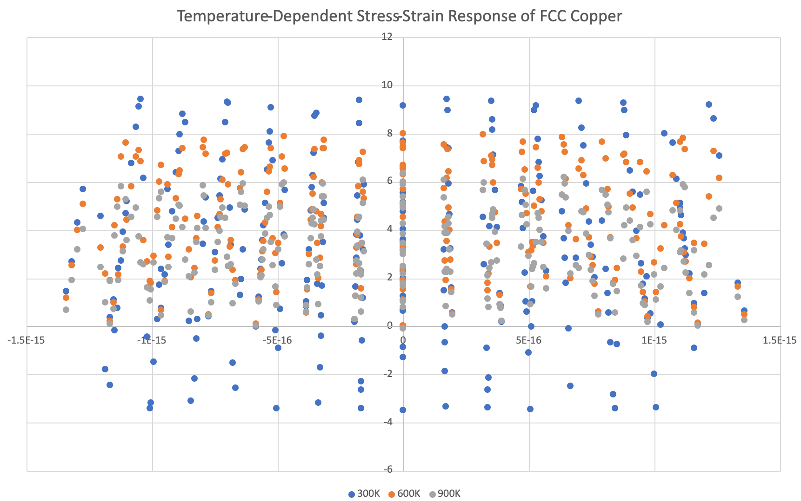

# Multi-Scale Materials Informatics Pipeline for Copper Tensile Deformation

This repository contains a fully automated computational framework designed to simulate, analyze, and predict the mechanical failure of an FCC Copper crystal lattice under varying thermal extremes.

## Technical Framework
* **Molecular Dynamics Engine:** LAMMPS (utilizing NPT ensembles and a 1 fs timestep)
* **Interatomic Potential:** NIST-validated Mishin EAM Copper Potential (`Cu01.eam.alloy`)
* **Visual Analytics:** OVITO (Dislocation Extraction Algorithm [DXA] & Virial Stress Mapping)
* **Data Processing:** Excel Automated Feature Extraction

## Project Workflow & Methodology
1. **Simulation Execution:** Applied a uniform tensile deformation rate of 10^9 s^-1 along the Z-axis of a pristine FCC Copper lattice.
2. **Parametric Thermal Sweep:** Conducted identical mechanical loading profiles across a strictly controlled temperature gradient: **300K (Ambient)**, **600K (Intermediate)**, and **900K (Extreme)**.
3. **Atomic Defect Tracking:** Implemented a Dislocation Extraction Algorithm (DXA) in OVITO to strip away structurally perfect FCC atoms, successfully isolating Shockley partial dislocations and tracking stacking fault trends.
4. **Macroscopic Engineering Graphs:** Extracted automated text dumps to plot smooth True Stress vs. Engineering Strain curves, highlighting the onset of structural yield limits.

### Note on the strain column in `stress_strain_*K.txt`
The committed data files were written by an earlier version of `in.cu_tensile.txt` that defined `L0` as an equal-style variable, which LAMMPS re-evaluates on every use, so the first (strain) column is always ~0. The script now freezes `L0` at the start of deformation. For the existing files the strain can be recovered from the row number: rows are printed every 100 steps of 1 fs at `erate 0.01` ps^-1, so the engineering strain of data row *n* (counting from 0) is `0.001 * n`, reaching 0.25 at the last row. Re-running the script produces the correct strain column directly.

## Re-running and plotting
Run the script once per temperature (the output files are named after `T`):

```
lmp -var T 300 -in in.cu_tensile.txt
lmp -var T 600 -in in.cu_tensile.txt
lmp -var T 900 -in in.cu_tensile.txt
```

Then `python plot_stress_strain.py` (needs numpy and matplotlib) plots every `stress_strain_*K.txt` in the folder to `stress_strain.png` and prints the first yield peak of each curve. It rebuilds the strain from the row number for the older files described above. On the committed data it gives:

| Temperature | Yield peak (GPa) | Strain at peak |
|---|---|---|
| 300 K | 9.46 | 0.121 |
| 600 K | 7.45 | 0.115 |
| 900 K | 5.07 | 0.092 |

`python -m pytest test_plot_stress_strain.py` checks the strain rebuild, the yield-peak pick and the values in this table. GitHub Actions (`.github/workflows/tests.yml`) runs these tests and the plot script on every push.

## Key Insights & Scientific Conclusions
* **Thermal Softening Verifications:** The quantitative data proves a stark reduction in maximum yield strength as the environment shifts from 300K to 900K.
* **Mechanism Identification:** Visually verified that elevated thermal energy acts as a direct kinetic catalyst, drastically lowering the energy barrier required for dislocation nucleation and forcing the crystal lattice to fail at significantly lower structural loads.

## Visual & Quantitative Analytics

### Microscopic Defect Evolution (OVITO Parametric Thermal Sweep)

#### 300K — Ambient Temperature (High Lattice Stability)
.jpg)

#### 600K — Intermediate Temperature (Early Defect Nucleation)
.jpg)

#### 900K — Extreme Temperature (Rapid Structural Breakdown)
.jpg)

### Macroscopic Stress-Strain Relationship (Excel Master Graph)

